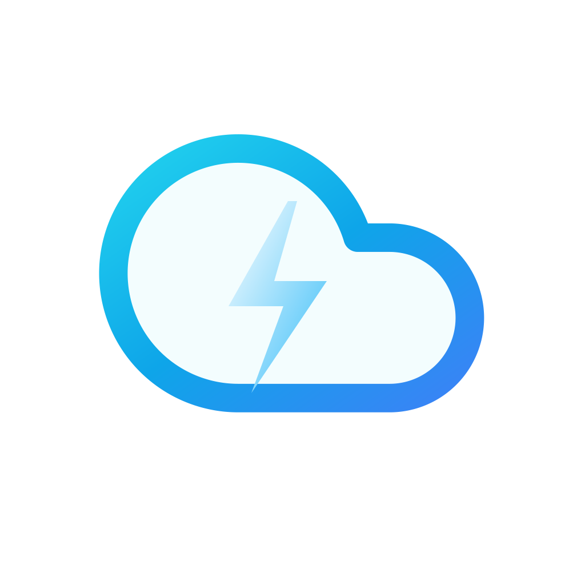

  

<h1 align="center">RapidXCloud Android</h1>

  <strong>rapidxcloud.in open source android apk</strong> 
  Official open-source Android client for <a href="https://rapidxcloud.in">rapidxcloud.in</a> — encrypted cloud storage vault with automated BYOS background backup and uncompressed direct folder downloads.

  
  
  
  

---

## Features

### End-to-End Encryption (E2EE)
* **Native Rust Cryptography**: Key derivation and cryptographic primitives run via JNI (`crypto-native`).
* **Argon2id Key Derivation**: Memory-hard parameters ($m=65536\text{ KB}, t=3, p=1$) defend against GPU brute-forcing.
* **Dual-Key Split**: Master file keys are split into shares ($\text{FileKey} = \text{ClientShare} \oplus \text{ServerShare}$).
* **Solo User Key Mode**: When enabled, zero key shares are sent to the backend.
* **4 MiB Streaming AES-256-GCM Chunks**: Large file transfers are encrypted in 4 MiB chunks with Associated Authenticated Data (AAD) index binding, keeping memory footprint under 30 MB.
* **32-Character Crockford Recovery Key**: Mnemonic recovery system allows vault restoration if credentials are forgotten.

### Automated Background Backup
* **Restricted to BYOS (Private Node) Accounts**: Available for users with connected personal bot tokens.
* **Real-Time Storage Monitoring**: Uses Android `ContentObserver` to detect new media writes (Camera, Screenshots, Downloads) and upload them promptly.
* **Mobile Directory Mirroring**: Preserves device folder structures (e.g., `DCIM/Camera` maps to `Mobile Backup/Camera`).
* **Hash Deduplication**: Tracks SHA-256 headers in a local Room database so existing files are never re-uploaded or overwritten.
* **Extension Filters**: Select which file extensions to back up (`jpg, png, mp4, mov, pdf, docx, zip, apk`).
* **Auto-Delete Local Copy**: Optional storage cleanup after successful backup is **disabled by default**.

### Direct Folder Download (No Zipping)
* Downloads full directory trees recursively into `Downloads/CanonDrive/`, preserving tree structure without requiring server-side zip compression.

### Remote URL Leeching
* Triggers remote downloads on high-speed server lanes (up to 2 Gbps) directly into your cloud vault, with stream selection, custom container naming, and subtitle options.

### System Share Sheet
* Supports uploading files directly to your vault from WhatsApp, Telegram, Gallery, Chrome, or any Android app via standard Android share intents.

---

## Bug Reports & Community Feedback

If you encounter bugs, glitches, or transfer errors:

1. Visit [**GitHub Issues**](https://github.com/aquib4040/RapidXCloud-Android/issues).
2. Submit an issue with:
   - Device model and Android version (Android 11+).
   - Steps to reproduce.
   - Relevant error logs.

---

## License

This project is licensed under the GNU General Public License v3.0 (GPL-3.0) — see [LICENSE](LICENSE) for details.
